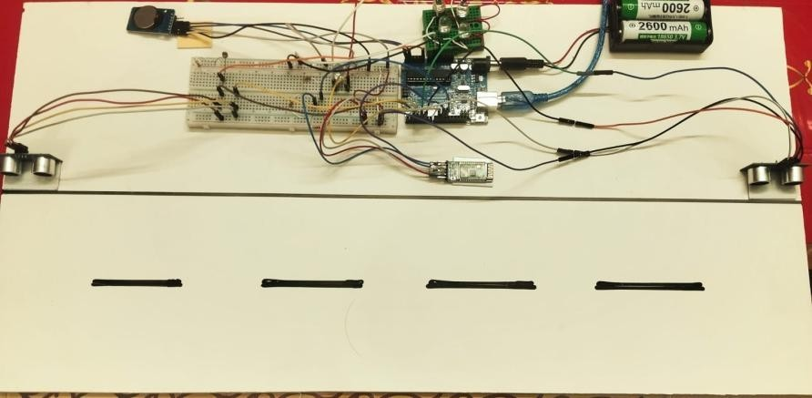

# Smart Street Lighting and Traffic Monitoring System for Energy Efficiency and Road Safety

An Arduino-based smart street lighting and traffic monitoring system designed to improve energy efficiency and road safety. The system combines ambient light sensing, time-based scheduling, vehicle detection, automatic LED brightness control, and Bluetooth communication for remote monitoring.

## Project Overview

Conventional street lights can consume unnecessary energy when they operate at full brightness regardless of traffic conditions. This project presents a low-cost prototype that adjusts street lighting according to ambient light and vehicle presence.

An Arduino Uno acts as the central controller. The LDR detects ambient light, the RTC module provides time information, ultrasonic sensors monitor vehicle presence, and an IR sensor supports vehicle counting. An HC-05 Bluetooth module enables wireless communication with a smartphone.

## Key Features

- **Automatic Light Control:** Uses an LDR sensor to detect ambient light and control street lights.
- **Time-Based Scheduling:** Integrates an RTC module for time-aware operation.
- **Traffic Monitoring:** Uses ultrasonic sensors for vehicle detection and an IR sensor for vehicle counting.
- **Adaptive Brightness:** Lights remain OFF during daytime, operate at approximately 35% brightness at night without traffic, and increase to 100% when a vehicle is detected.
- **Bluetooth Communication:** Supports wireless monitoring and manual control through a smartphone.
- **Energy Efficiency:** Reduces unnecessary lighting by dimming the lights when traffic is absent.
- **Low-Cost Design:** Developed as an affordable prototype for smart-city applications.

## Hardware Components

- Arduino Uno
- LDR sensor
- RTC module
- Two HC-SR04 ultrasonic sensors
- IR sensor module
- HC-05 Bluetooth module
- LED street lights and compatible driver
- Power supply and connecting wires


## System Model


The system model illustrates the main hardware components and their connections to the Arduino Uno controller.

## Hardware Prototype



The prototype demonstrates the integration of the controller, sensors, Bluetooth module, and LED street lights.

## Flowchart and Block Diagram


The control process initializes the components, checks ambient light, monitors vehicle presence at night, adjusts LED brightness, and updates monitoring information.

## Algorithm

The system follows an automatic sensing and control algorithm to manage street lighting based on ambient light and vehicle detection.

1. **Initialize the System:** Initialize the Arduino, LDR sensor, RTC module, ultrasonic sensors, IR sensor, LED driver, and Bluetooth communication.
2. **Read Ambient Light:** Measure the surrounding light intensity using the LDR sensor.
3. **Check Day or Night:** If daytime is detected, turn the street lights OFF. Otherwise, proceed to traffic monitoring.
4. **Monitor Traffic:** Read ultrasonic sensor measurements to detect vehicles and use the IR sensor for vehicle counting.
5. **Adjust Lighting:** If a vehicle is detected at night, increase LED brightness to 100%. If no traffic is detected, maintain approximately 35% brightness.
6. **Update Monitoring:** Transmit relevant traffic information and system status through the HC-05 Bluetooth module for smartphone monitoring.
7. **Repeat:** Continuously repeat the sensing, decision-making, lighting control, and monitoring steps.

### Algorithm Flow

```text
Start
  |
Initialize System
  |
Read Ambient Light (LDR)
  |
Daytime?
  | Yes                    | No
Lights OFF              Monitor Traffic
                            |
                    Vehicle Detected?
                      | Yes       | No
                  Brightness    Brightness
                    100%           35%
                      |              |
                      +------+-------+
                             |
                    Update Bluetooth Data
                             |
                      Repeat Process
```

## Automatic Light Control Results


| Operating Condition | LED Brightness |
|---|---:|
| Daytime | 0% — OFF |
| Nighttime, No Traffic | 35% |
| Nighttime, Vehicle Detected | 100% |

## Energy Consumption Comparison


| System | Daily Energy Consumption | Monthly Energy Consumption |
|---|---:|---:|
| Conventional Lighting | 1.20 kWh | 36.00 kWh |
| Proposed Smart System | 0.52 kWh | 15.60 kWh |

According to the project report, the proposed system achieves approximately **56.7% energy savings** compared with conventional lighting operating continuously at full brightness.

| System | Daily Energy Consumption | Monthly Energy Consumption |
|---|---:|---:|
| Conventional Lighting | 1.20 kWh | 36.00 kWh |
| Proposed Smart System | 0.52 kWh | 15.60 kWh |

According to the project report, the proposed system achieves approximately **56.7% energy savings** compared with conventional lighting operating continuously at full brightness.

## Bluetooth Communication

The project report records the following Bluetooth communication results:

| Parameter | Reported Value |
|---|---|
| Bluetooth Module | HC-05 |
| Communication Range | Approximately 10 m |
| Baud Rate | 9600 bps |
| Packet Loss | Less than 1% |
| Data Transmission Delay | 0.25–0.35 s |

## Getting Started

1. Assemble the hardware according to the circuit diagram and system model.
2. Connect the sensors, RTC module, Bluetooth module, and LED driver to the Arduino Uno.
3. Open the Arduino source code in the Arduino IDE.
4. Verify the pin configuration and required libraries.
5. Upload the program to the Arduino Uno.
6. Test the lighting response during daytime, nighttime without traffic, and nighttime with vehicle detection.
7. Pair a smartphone with the HC-05 Bluetooth module to test wireless communication.

**Note:** Add the Arduino source code and circuit diagram to this repository so that others can reproduce the project. Adjust sensor thresholds and brightness settings according to the actual hardware.

## Future Improvements

- Integrate IoT and cloud platforms for long-range monitoring.
- Apply AI-based traffic analysis for adaptive lighting decisions.
- Add solar power and battery storage.
- Implement automatic fault detection and maintenance alerts.
- Develop a mobile or web dashboard for traffic and energy statistics.
- Explore LoRa, Wi-Fi, or GSM for wider-area communication.
- Add emergency vehicle detection and priority lighting.

## Technologies Used

- **Microcontroller:** Arduino Uno
- **Programming:** Arduino C/C++
- **Sensors:** LDR, HC-SR04 ultrasonic sensors, IR sensor
- **Communication:** HC-05 Bluetooth
- **Control:** RTC scheduling and PWM-based LED brightness control
- **Application Areas:** Smart Infrastructure, Energy Efficiency, and Road Safety

## Project Information

- **Project Type:** Electronics and Embedded Systems
- **Course:** EEE 3100 — Electronics Shop Practice
- **Institution:** Rajshahi University of Engineering & Technology (RUET)
- **Reported Project Cost:** BDT 1,800

## Conclusion

This project demonstrates a low-cost approach to intelligent street lighting and traffic monitoring by combining environmental sensing, time-based control, vehicle detection, adaptive illumination, and wireless communication. The prototype highlights the potential of embedded systems to improve energy efficiency and support safer, smarter urban infrastructure.

